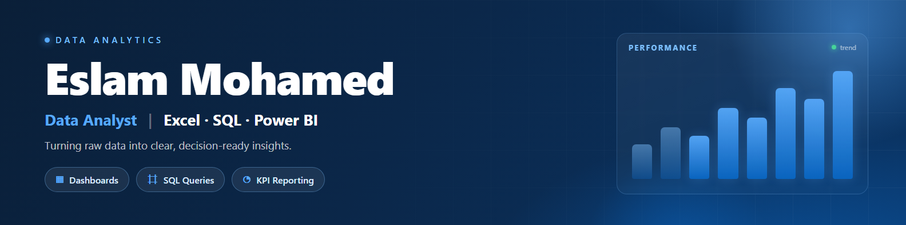

# دليل بروفايل لينكدإنب لمحلل البيانات 🚀
# LinkedIn Profile Guide for Aspiring Data Analysts

محتوى عربي عملي لبناء بروفايل احترافي على **LinkedIn** كمحلل بيانات (Data Analyst)، مخصص للناس اللي **لسه في مرحلة التعلم** أو بتحوّل مسارها المهني.

> 📌 مبني على أفضل الممارسات (2025–2026) في تحسين البروفايلات: ترتيب أولويات الأقسام، الكلمات المفتاحية اللي الريكراترز بيدوروا بيها، وإزاي تظهر مهاراتك قبل ما يكون عندك خبرة رسمية.

---

## 📂 محتويات الريبو

| الملف | الوصف |
|---|---|
| [`guide-ar.md`](guide-ar.md) | الدليل الكامل: كل قسم في البروفايل + إيه اللي تكتبه جواه + خطة تنفيذ 30 يوم + أخطاء شائعة |
| [`profile-sample.md`](profile-sample.md) | نموذج بروفايل جاهز للنسخ (نص) لشخص في مرحلة التعلم — Excel · SQL · Power BI |
| [`profile-sample.html`](profile-sample.html) | نفس النموذج بشكل بصري بيحاكي صفحة LinkedIn |
| [`cover/`](cover) | الكوفر (Banner) بمقاس LinkedIn الرسمي **1584×396** — [PNG](cover/linkedin-cover.png) جاهز للرفع + [HTML](cover/linkedin-cover.html) قابل للتعديل |

---

## 🖼️ شكل الكوفر

---

## ⚡ أهم النقاط السريعة

- **الترتيب بالأهمية:** `Headline` → أول 3 أسطر من `About` → وظيفتك الحالية في `Experience` → أول 3 مهارات في `Skills` → `Featured`/`Projects`.
- **الكلمة المفتاحية "Data Analyst"** لازم تظهر في **أول 40 حرف** من الـ Headline (الموبايل بيقطع بعد كده).
- **خبرتك السابقة مهمة:** ماتمسحهاش — حوّل مهامك العادية لـ `فعل + اللي عملته + نتيجة`.
- **المشاريع أقوى من الشهادات:** 3 مشاريع موثّقة (Problem → Approach → Insight → Link) > 10 مشاريع copy-paste.
- **فعّل Open to Work** بوضع **Recruiters only**، وخلّي البروفايل `Public`.

التفاصيل الكاملة في [`guide-ar.md`](guide-ar.md).

---

## 🛠️ الخطوات المقترحة

1. اقرأ `guide-ar.md` بالترتيب.
2. افتح `profile-sample.md` وبدّل أي حاجة بين `[أقواس]` بمعلوماتك.
3. عدّل الـ Cover من `cover/linkedin-cover.html` (الألوان/النص) — أو استخدم الـ PNG جاهز.
4. نفّذ الخطة خلال 30 يوم.

---

## 📄 License

محتوى تعليمي مفتوح — استخدمه وعدّله بحرية.
